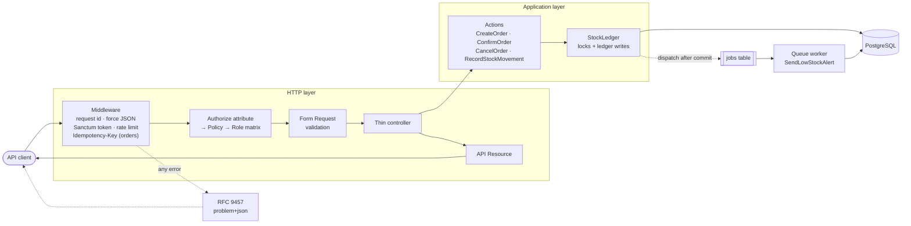
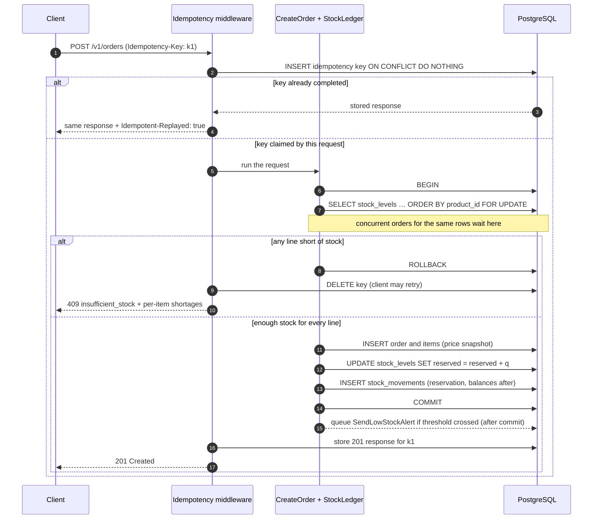
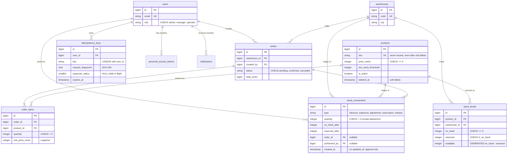

# StockFlow API

[](https://github.com/Velosog/stockflow-api/actions/workflows/ci.yml)

A multi-warehouse inventory and order management REST API for a (fictional) small distributor, built with **Laravel 13, PHP 8.4 and PostgreSQL 18**.

It focuses on the parts of backend work that are easy to get wrong: **concurrent stock reservations without overselling**, an **append-only stock ledger**, **idempotent order creation**, role-based authorization on every endpoint, queued alerts, and a consistent error format. Everything is covered by tests that run against a real PostgreSQL database, including a test that races real parallel processes for the last units of stock.

| | |
|---|---|
| Stack | Laravel 13 · PHP 8.4 · PostgreSQL 18 · Sanctum · FrankenPHP · Docker Compose |
| Quality | Pest 5 (162 tests) · PHPStan/Larastan level 8 · Pint · GitHub Actions |
| Security | gitleaks (pre-commit + CI) · Dependabot · `composer audit` · rate limiting · policies |
| API docs | OpenAPI 3.1 generated from code (Scramble), exported to [`docs/openapi.json`](docs/openapi.json) |

---

## Contents

- [Domain](#domain)
- [Architecture](#architecture)
- [Data model](#data-model)
- [Key decisions and trade-offs](#key-decisions-and-trade-offs)
- [API overview](#api-overview)
- [Run locally on Windows (Docker)](#run-locally-on-windows-docker)
- [Tests and code quality](#tests-and-code-quality)
- [Security](#security)
- [What I would do next](#what-i-would-do-next)

---

## Domain

- **Users** authenticate with API tokens and have one role: `admin`, `manager` or `operator`.
- **Products** have a unique SKU, a price in integer cents, an active flag, a low-stock threshold and soft deletes.
- **Warehouses** hold stock. Stock is tracked **per product per warehouse**.
- Every stock change is a **movement** in an append-only ledger: `inbound`, `adjustment`, `reservation`, `release`, `outbound`.
- **Orders** are fulfilled from one warehouse. Creating an order **reserves** stock; confirming turns the reservation into an **outbound** movement; cancelling **releases** it.

```text
pending ──confirm──▶ confirmed      (final)
   │
   └────cancel────▶ cancelled       (final)       any other transition → 409
```

- When available stock **crosses below** a product's threshold, a **queued job** notifies every manager (database notification).

### Who can do what

| Action | admin | manager | operator |
|---|:-:|:-:|:-:|
| Read products, warehouses, stock, orders | ✓ | ✓ | ✓ |
| Create / update / delete / restore products | ✓ | ✓ | |
| Create / update / delete warehouses | ✓ | | |
| Manage users | ✓ | | |
| Record goods received (`inbound`) | ✓ | ✓ | ✓ |
| Adjust stock (`adjustment`, reason required) | ✓ | ✓ | |
| Create orders | ✓ | ✓ | ✓ |
| Confirm orders | ✓ | ✓ | |
| Cancel orders | any | any | own only |
| Receive low-stock alerts | | ✓ | |

The matrix lives in one place, [`app/Enums/Role.php`](app/Enums/Role.php), and policies delegate to it. It is tested as a table in [`tests/Unit/Enums/RoleTest.php`](tests/Unit/Enums/RoleTest.php).

---

## Architecture

### Request flow



- **Controllers are thin**: they authorize (via Laravel 13 `#[Authorize]` attributes), take validated input and return an API Resource.
- **Business rules live in Actions** (`app/Actions`) and in **`StockLedger`** (`app/Services/StockLedger.php`), the only code that changes stock.
- **Models** hold relationships, casts and query scopes only. Enums own their own rules (`OrderStatus::canTransitionTo`, `StockMovementType::onHandDelta`).
- Plain CRUD (products, warehouses) stays in the controller: wrapping `Product::create()` in an action would add a layer without adding behaviour.

### Stock reservation flow



---

## Data model



Indexes worth pointing out: `stock_levels (product_id, warehouse_id)` is unique and is the row every reservation locks; `stock_levels (warehouse_id, available)` serves the low-stock listing; `stock_movements (product_id, warehouse_id, created_at)` serves ledger history; a **trigram GIN index** (`pg_trgm`) on `products.name` lets `?search=` use an index for `ILIKE '%term%'`.

---

## Key decisions and trade-offs

### 1. Append-only ledger **plus** denormalised stock levels

Every change is a row in `stock_movements`. The ledger is the audit trail and the source of truth: you can always explain *why* a number is what it is. Rows are never updated or deleted. A **PostgreSQL trigger** rejects `UPDATE` and `DELETE`, so this holds even for code that bypasses the application. Corrections are new `adjustment` rows with a mandatory reason.

Summing the ledger on every read would be slow and gives nothing to lock. So `stock_levels` keeps the current `on_hand` and `reserved` per product and warehouse, **updated in the same transaction** as the movement. Three things keep the two consistent:

- `available` is a **generated column** (`on_hand - reserved`), so it cannot drift;
- **CHECK constraints** (`on_hand >= 0`, `0 <= reserved <= on_hand`) are a last line of defence;
- each movement stores `on_hand_after` / `reserved_after`, so a reconciliation job can verify the projection against the ledger. A test already asserts that levels equal the sum of the ledger.

*Trade-off:* two writes per movement and one more table to keep consistent, in exchange for O(1) reads, a natural lock target and a full history.

### 2. Pessimistic row locks for reservations

`StockLedger::lockLevels()` runs `SELECT … FOR UPDATE` on the order's stock-level rows **inside the transaction**, then checks availability and writes. A second request for the same product and warehouse waits until the first commits, then reads the new value. Rows are always locked in **ascending `product_id` order**, so two multi-line orders can never deadlock each other. Confirm and cancel lock the **order row first, then the levels**, the same global order, so two people cannot confirm and cancel the same order at once.

Why not the alternatives?

- *Optimistic locking (version column + retry)* works, but under contention for a popular SKU most requests fail and retry. For a multi-line order, "retry everything" is costly.
- *A single conditional `UPDATE … WHERE available >= q`* is great for one row, but an order has many lines and must be **all-or-nothing**. With row locks the code checks every line first, reports **all** shortages in one 409, and reserves nothing if any line is short.

**Proof:** [`tests/Concurrency/StockReservationConcurrencyTest.php`](tests/Concurrency/StockReservationConcurrencyTest.php) starts 10–12 **separate PHP processes** (each with its own DB connection), lines them up behind a file barrier and releases them at once against 5 units of stock. Exactly 5 orders succeed, the rest get a clean `insufficient_stock`, and the ledger matches the levels. As a mutation check I removed `lockForUpdate()`: **all 12 orders succeeded for 5 units.** The CHECK constraint did not catch it, because each process read `reserved = 0` and wrote `reserved = 1`, a classic *lost update* that is valid row by row. The lock is what prevents overselling; the constraints only back it up.

*Trade-off:* orders for the same hot SKU in the same warehouse are serialised. Transactions are kept short (no external calls inside them) so the wait stays small. At much higher volumes I would consider a per-SKU reservation queue.

### 3. Idempotency keys on `POST /v1/orders`

Mobile networks and load balancers retry. Without protection, a retried "create order" reserves stock twice. Clients may send an `Idempotency-Key` header (as in Stripe and the IETF *Idempotency-Key* draft):

| Situation | Response |
|---|---|
| First request | runs normally; a 2xx response is stored |
| Same key, same body | stored response replayed, `Idempotent-Replayed: true`, nothing runs |
| Same key, different body | `422 idempotency_key_reused` |
| Same key while the first is still running | `409 idempotency_request_in_progress` |
| First request failed (e.g. 409 out of stock) | key released, so the client may retry with the same key |

The key is **claimed atomically** with `INSERT … ON CONFLICT DO NOTHING` *before* the request runs, which makes two simultaneous retries safe. Keys are **scoped per user**, the fingerprint is a SHA-256 of method, path and the body with sorted keys (key order does not matter), and keys expire after 24 h (pruned daily). The stored body is `text`, not `jsonb`: `jsonb` reorders keys, so the replay would not be byte-identical.

*Known limitation:* the response is stored right after the order transaction commits, not inside it. If the process died exactly between the two, a retry would get `409 in progress` until the key expires (but no duplicate order). See [What I would do next](#what-i-would-do-next).

### 4. One error format: RFC 9457 problem details

Every API error (401, 403, 404, 405, 409, 422, 429, 500) is `application/problem+json` with a stable, machine-readable `code` and the request's correlation id:

```json
{
  "title": "Conflict",
  "status": 409,
  "code": "insufficient_stock",
  "detail": "Not enough available stock for one or more items.",
  "shortages": [{ "product_id": 3, "sku": "CB-CAT6-30", "requested": 6, "available": 5 }],
  "request_id": "6f1c0a52-8a43-4f0e-9a49-7d9d6b1f0e2b"
}
```

Messages never expose internals. For example, the default Laravel 404 names the Eloquent model class, and here it is replaced with a generic message, even with `APP_DEBUG=true`. Business-rule violations (`DomainRuleException`) are expected outcomes and are not reported to the error log.

### 5. Other choices

- **PostgreSQL everywhere, including tests.** Row locks, generated columns, CHECK constraints, triggers and `pg_trgm` are part of the behaviour under test. SQLite would make the suite faster but would not test these.
- **Actions, not repositories.** Eloquent already is the data-access layer. A repository on top would mostly forward calls. Actions name the use cases (`CreateOrder`, `ConfirmOrder`) and are unit-tested directly.
- **Scramble for OpenAPI.** It infers the spec from Form Requests, Resources and return types, so the docs come from the same code that serves requests and cannot silently drift. Annotation-based tools (e.g. `l5-swagger`) duplicate the contract by hand. Scribe was the other candidate; Scramble's OpenAPI 3.1 output and zero-annotation approach won.
- **FrankenPHP in one image** for the API, the queue worker and the scheduler: one Dockerfile, no nginx + php-fpm pair to configure. **Laravel Sail** was not used because on Windows it requires running its bash script inside WSL. Plain `docker compose` works from PowerShell.
- **Money as integer cents**, prices **snapshotted** on order items so catalog changes never alter past orders.

---

## API overview

Base URL: `http://localhost:8000/api/v1`. Every route except login needs `Authorization: Bearer <token>`.

| Method | Path | Who | Notes |
|---|---|---|---|
| POST | `/auth/login` | public | returns a token once (`sf_…` prefix, expires in 24 h) |
| GET | `/auth/me` | any | current user |
| POST | `/auth/logout` | any | revokes the current token |
| GET / POST | `/users` | admin | list (filter `role`) / create |
| GET / POST | `/products` | read: any · write: admin, manager | `search`, `is_active`, `per_page` (max 100) |
| GET / PATCH / DELETE | `/products/{id}` | read: any · write: admin, manager | delete is a soft delete |
| POST | `/products/{id}/restore` | admin, manager | |
| GET / POST | `/warehouses` | read: any · write: admin | `city` filter |
| GET / PATCH / DELETE | `/warehouses/{id}` | read: any · write: admin | delete → 409 once it has history |
| GET | `/stock-levels` | any | `product_id`, `warehouse_id`, `low_stock=true` |
| GET | `/stock-movements` | any | ledger, newest first; `product_id`, `warehouse_id`, `order_id`, `type` |
| POST | `/stock-movements` | inbound: any · adjustment: admin, manager | adjustments require `note` |
| GET / POST | `/orders` | any | create accepts `Idempotency-Key`; 409 with shortages |
| GET | `/orders/{id}` | any | |
| POST | `/orders/{id}/confirm` | admin, manager | 409 if not pending |
| POST | `/orders/{id}/cancel` | admin, manager, or the operator who created it | optional `reason` |
| GET | `/notifications` | any (own only) | `unread=true` |
| POST | `/notifications/{id}/read` | any (own only) | another user's id → 404 |
| GET | `/up` | public | health check (outside `/api`) |

**Interactive docs:** <http://localhost:8000/docs/api> (Stoplight Elements) and the raw spec at <http://localhost:8000/docs/api.json>. By default they are served only when `APP_ENV=local`. The exported spec is versioned in [`docs/openapi.json`](docs/openapi.json); regenerate it with `php artisan scramble:export --path=docs/openapi.json`.

**Rate limits** (per minute, configurable in `.env`): login 5 per email + IP (and 20 per IP), 120 requests per user, 30 writes per user. Exceeding them returns `429` with `Retry-After`.

---

## Run locally on Windows (Docker)

Requirements: **Docker Desktop** (WSL 2 backend) and **Git**. PHP is not needed on the host.

```powershell
git clone https://github.com/Velosog/stockflow-api.git
cd stockflow-api

Copy-Item .env.example .env          # set DB_PASSWORD to any local value
docker compose build
docker compose run --rm --no-deps app php artisan key:generate
docker compose run --rm app php artisan migrate --seed
docker compose up -d
```

The stack is `app` (API on <http://localhost:8000>), `queue` (worker), `scheduler` (token and idempotency-key pruning) and `postgres` (port 5432). Check it with `docker compose ps`. `app` turns *healthy* once `/up` answers.

**Demo accounts** (seeded, local only, password `password`): `admin@stockflow.test`, `manager@stockflow.test`, `operator@stockflow.test`. The seeder refuses to run in production.

```powershell
$login = Invoke-RestMethod -Method Post -Uri http://localhost:8000/api/v1/auth/login `
  -ContentType 'application/json' `
  -Body '{"email":"manager@stockflow.test","password":"password","device_name":"powershell"}'
$headers = @{ Authorization = "Bearer $($login.data.token)" }

Invoke-RestMethod http://localhost:8000/api/v1/stock-levels?low_stock=true -Headers $headers
```

Useful commands:

```powershell
docker compose logs -f app queue                  # follow logs
docker compose exec app php artisan tinker        # REPL
docker compose up -d --build --renew-anon-volumes # after changing composer.lock
docker compose down                               # stop (add -v to delete the database)
```

**Without Docker** (for example with Laravel Herd): PHP 8.4 with `pdo_pgsql` and a local PostgreSQL 16+ with databases `stockflow` and `stockflow_testing`. Then run `composer install`, `php artisan key:generate`, `php artisan migrate --seed`, `php artisan serve` and, in another terminal, `php artisan queue:work`.

---

## Tests and code quality

```powershell
docker compose exec app composer test       # Pest: unit, feature and concurrency suites
docker compose exec app composer lint       # Pint --test (PSR-12 + Laravel preset, strict_types)
docker compose exec app composer analyse    # PHPStan / Larastan level 8
docker compose exec app composer check      # all three
```

Tests use a separate `stockflow_testing` database (created by `docker/postgres/init`).

| Suite | What it covers |
|---|---|
| `tests/Unit` | role matrix, state machine, movement effects, `StockLedger` invariants, DB constraints and the append-only trigger, `CreateOrder`, confirm/cancel, token issuing |
| `tests/Feature` | every endpoint: happy path, validation (422), **401 and 403 for each role**, 404, 409, 429, idempotency, low-stock alerts, notifications, OpenAPI document |
| `tests/Concurrency` | real parallel processes racing to reserve the same stock |

Feature and unit tests run inside a transaction that is rolled back. The concurrency suite has to commit data, because other processes cannot see an open transaction, so it truncates the tables afterwards.

**CI** ([`.github/workflows/ci.yml`](.github/workflows/ci.yml)) runs on every push and pull request: `composer validate --strict` and `composer audit`, Pint, PHPStan, Pest against a PostgreSQL 18 service, a **Docker Compose smoke test** (build, migrate, seed, start, call `/up` and log in), and a **gitleaks** scan of the full git history.

---

## Security

- **Tokens:** Sanctum personal access tokens; only a SHA-256 hash is stored. They carry an `sf_` prefix (secret scanners can recognise leaks), expire after 24 h and are pruned daily. Logout revokes the current token.
- **Login:** the same message for an unknown email and a wrong password, and a timing-equalising hash check, so responses do not reveal which emails exist. Rate limited per account + IP and per IP.
- **Authorization:** a policy check on every endpoint (`#[Authorize]` attributes, or `Gate::authorize` where the rule depends on the request body). Notifications are queried through the owner's relation, so another user's id returns 404.
- **Input:** Form Requests on every write and list endpoint; `LIKE` wildcards are escaped; page size capped at 100; passwords need 12+ characters with mixed case and numbers, plus a breached-password check (HaveIBeenPwned k-anonymity API) in production.
- **Output:** problem details without internals; `X-Content-Type-Options`, `X-Frame-Options`, `Referrer-Policy` and `Cache-Control: no-store` headers; `expose_php=Off` in the image; every response has an `X-Request-Id`, which is also added to every log line.
- **Configuration:** secrets only through environment variables. `.env` is git-ignored and never baked into the image (`.dockerignore`). **Production must run with `APP_ENV=production` and `APP_DEBUG=false`**, otherwise Laravel's debug pages can leak configuration. Destructive database commands are blocked in production.
- **Supply chain:** Dependabot (Composer, GitHub Actions, Docker), `composer audit` in CI, gitleaks as a pre-commit hook and in CI.

See [SECURITY.md](SECURITY.md) to report a vulnerability.

---

## What I would do next

1. **Exactly-once idempotency:** store the idempotency key's result in the *same* transaction as the order (or link the key to the order id), closing the crash window described above.
2. **Reservation expiry:** a scheduled job that cancels pending orders older than N hours and releases their stock.
3. **Ledger reconciliation:** a nightly job that recomputes levels from `stock_movements` and alerts on any difference.
4. **Transfers between warehouses** as paired movements in one transaction, and split orders across warehouses.
5. **Transactional outbox** for domain events (order confirmed, stock low), so integrations (ERP, e-mail, webhooks) are reliable and decoupled from the request.
6. **Observability:** structured JSON logs, OpenTelemetry traces and metrics (lock wait time, 409 rate per SKU).
7. **Production image hardening:** non-root user, no dev dependencies, read-only filesystem, and a deploy pipeline (e.g. ECS or Fly.io) with migrations as a release step.
8. **Finer token scopes** (Sanctum abilities per role) and short-lived tokens with refresh.
9. **Contract tests** generated from `docs/openapi.json`, and automated mutation testing (Infection) to keep the test suite honest.

---

## Project layout

```text
app/
  Actions/        use cases: Auth, Orders (Create, Confirm, Cancel), Stock, Warehouses
  Enums/          Role (permission matrix), OrderStatus (state machine), StockMovementType
  Exceptions/     DomainRuleException + specific rules, ApiExceptionRenderer (RFC 9457)
  Http/           thin controllers (Api/V1), middleware, Form Requests, Resources
  Jobs/           SendLowStockAlert
  Models/         Eloquent models: relationships, casts, scopes
  Notifications/  LowStockNotification (database channel)
  Policies/       one per resource, delegating to Role
  Services/       StockLedger: the only code that changes stock
database/         migrations (constraints, trigger, indexes), factories, demo seeder
docker/           PostgreSQL init script
docs/             exported OpenAPI 3.1 spec
tests/            Unit, Feature, Concurrency (+ worker script)
```

## License

[MIT](LICENSE)
